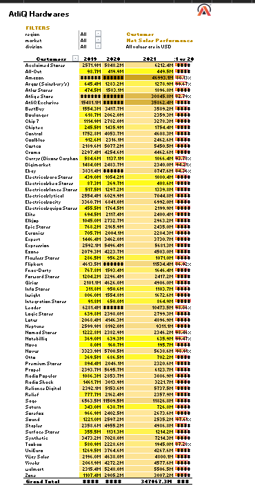
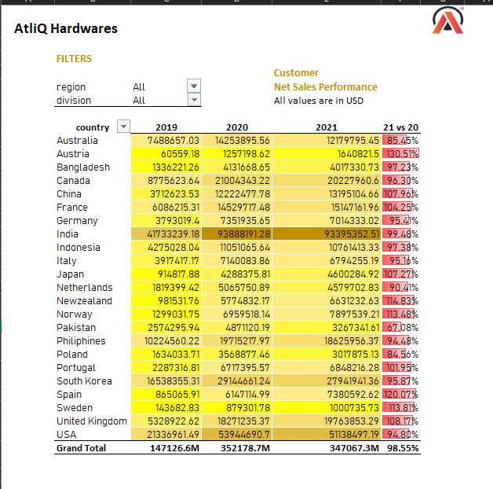

# 📈 AtliQ Hardwares — Customer & Market Net Sales Performance (Excel Analytics)

A comprehensive Excel Business Intelligence & Financial Reporting project analyzing multi-year Net Sales performance (2019–2021) and Year-over-Year (`21 vs 20`) growth trends across customers and international markets for **AtliQ Hardwares**.

## 🎯 Project Overview
This project transforms raw multi-year sales data into automated, executive-ready financial performance reports. It tracks **$347,067.3M in total 2021 Net Sales** (98.55% YoY performance compared to 2020's $352,178.7M) with dynamic filtering and conditional formatting to highlight top-performing accounts and emerging regional markets.

## 📊 Key Reports & Insights
1. **Customer Net Sales Performance Report:**
   * Evaluates annual revenue across 70+ retail and e-commerce partners (e.g., Amazon at $46,993.1M, AtliQ Exclusive at $35,862.4M, AtliQ e Store at $30,845.8M, and Flipkart at $11,534.4M in 2021).
   * Features interactive slicers/filters for **Region**, **Market**, and **Division**, alongside conditional data bars and YoY variance highlights (`21 vs 20`).
2. **Market Net Sales Performance Report:**
   * Breaks down revenue performance across 22 global countries from 2019 to 2021.
   * Highlights major revenue contributors (India at $93.40M, USA at $51.14M, South Korea at $27.94M, Canada at $20.23M) and high-growth markets such as **Austria (130.51%)**, **Spain (120.07%)**, **New Zealand (114.83%)**, and **Norway (113.48%)**.

## 🛠️ Tools & Excel Techniques Used
* **Microsoft Excel:** Pivot Tables, Power Query (ETL data cleaning and merging), Power Pivot (Data Modeling & DAX measures), Conditional Formatting (data bars & color scales), and interactive report slicers.
* **GitHub:** Version control and portfolio documentation.

## 📸 Report Previews

### 1. Customer Performance Report

### 2. Market Performance Report

## 📂 Repository Structure
* `/reports` — Contains the complete `.xlsx` Excel workbook with interactive Pivot Tables and financial reports.
* `/screenshots` — High-resolution previews of the Customer and Market Performance reports.
* `/data` — Raw dataset files used to build the data model.
